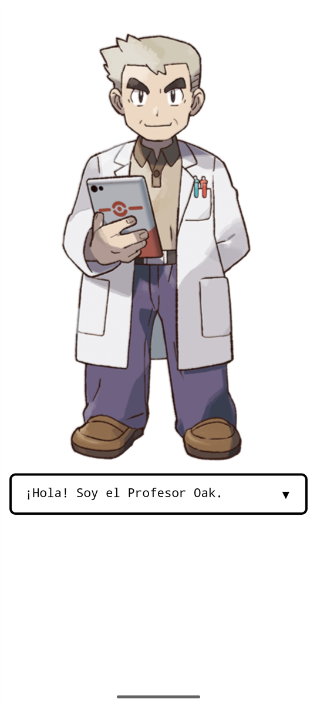
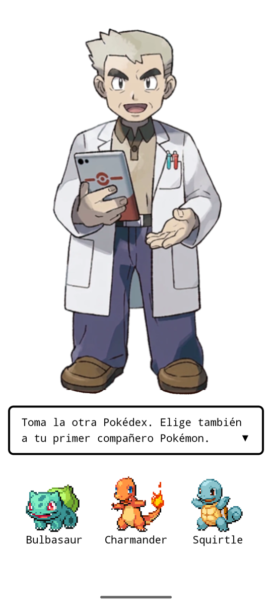
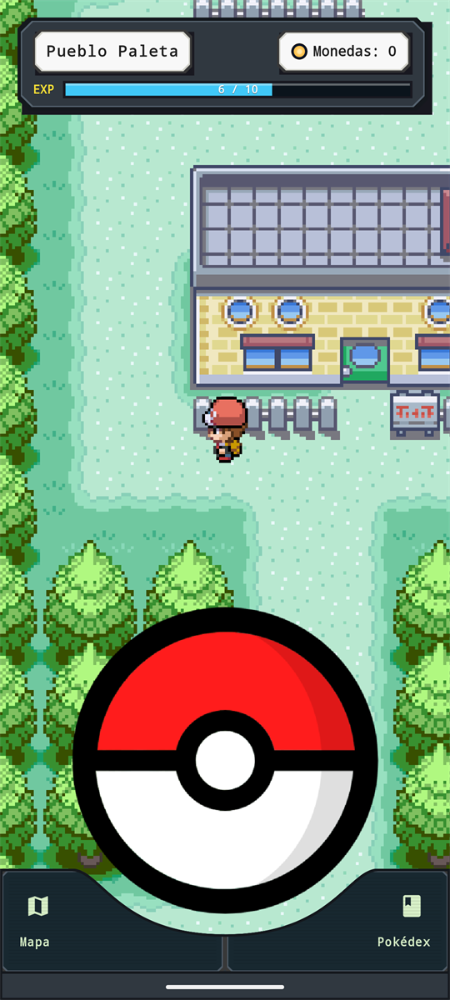
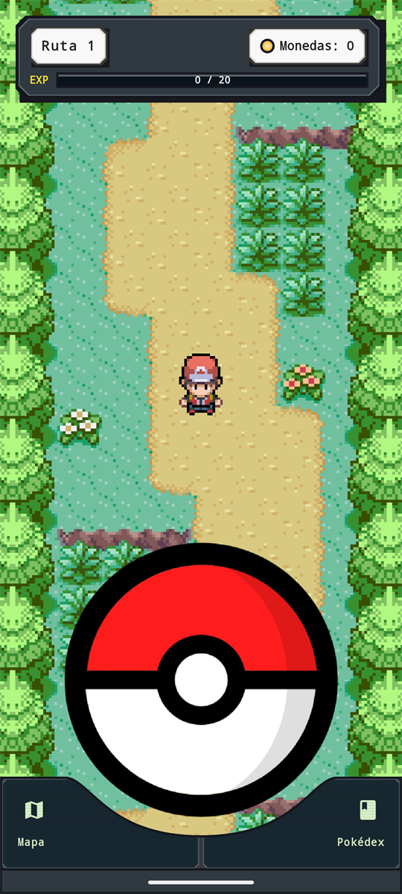
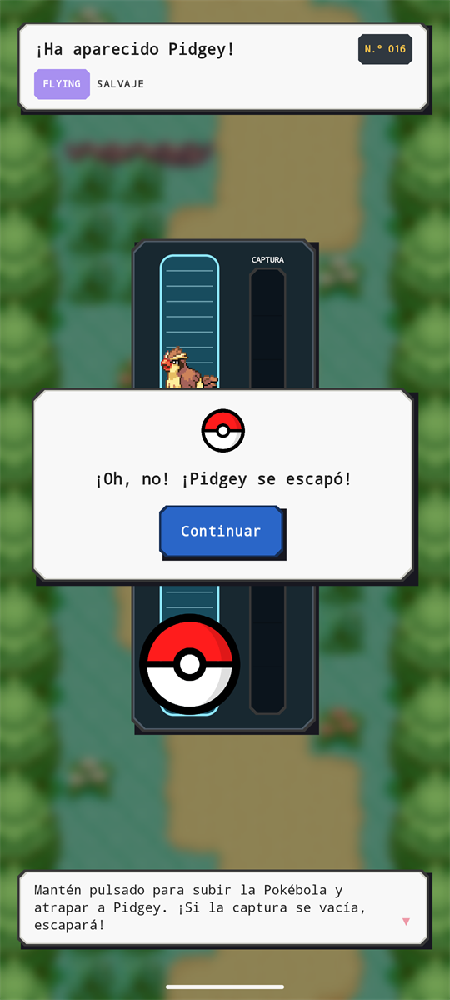
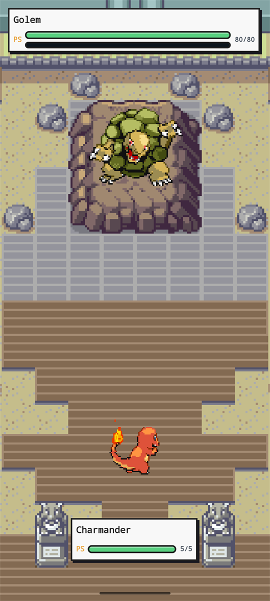
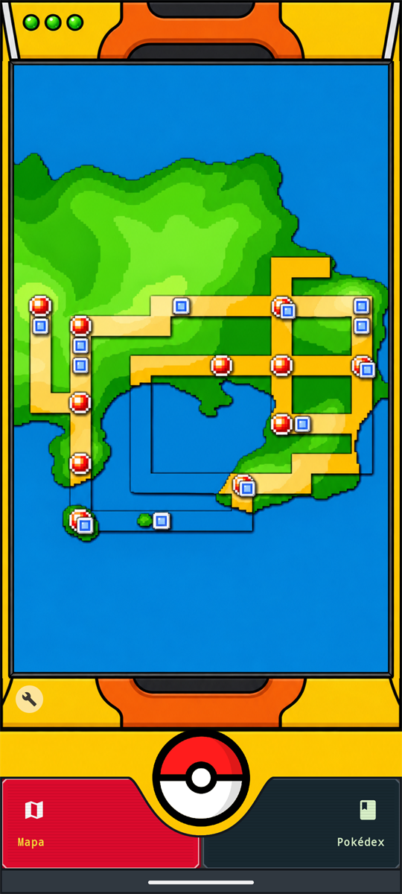
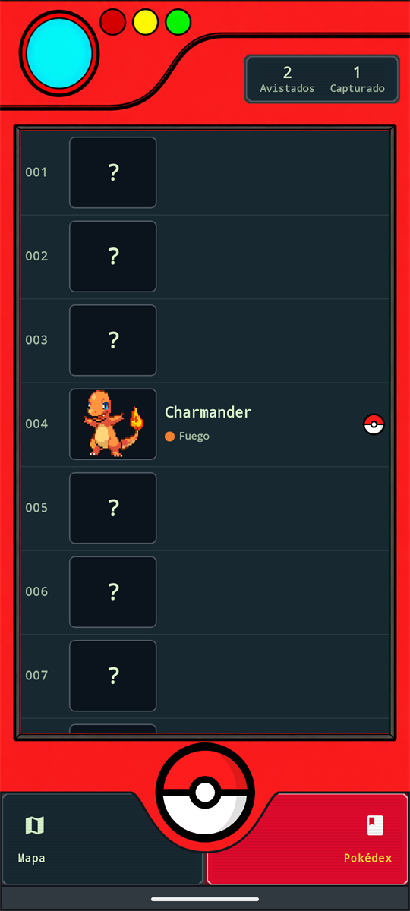

# Pokeclic

Pokeclic es un juego **clicker** para Android ambientado en la primera generación
de Pokémon. Avanzas por Kanto pulsando la Pokébola, aparecen Pokémon salvajes
mientras caminas, los capturas en un minijuego de barra y desafías a los líderes
de gimnasio. El objetivo es conseguir las 8 medallas y completar las 151 entradas
de la Pokédex.

|  |  |
| --- | --- |
| Introducción: Oak pide tu nombre y tu primer compañero. | Selector de starter con los tres sprites animados. |

## El juego en una página

- **13 zonas jugables** de Kanto, con fondo animado propio en 8 de ellas.
- **Minijuego de captura** de riel vertical con barra, gravedad y dificultad por
  especie.
- **Pokédex de 151 especies** con estados avistado / registrado / capturado.
- **Mapa de Kanto** con zoom, desplazamiento e indicador de la zona tocada.
- **3 gimnasios** con mecánicas distintas: rocas (Brock), anillos (Misty) y
  cuadrícula de Voltorb (Lt. Surge).
- **Introducción del Profesor Oak** y tutorial guiado para partidas nuevas.

### Bucle de juego

1. Cada toque en la Pokébola suma `clickPower` al progreso de la zona. El
   progreso **se capa en el umbral**: llegar al 100 % no avanza solo.
2. El mismo toque marca actividad de caminata. En zonas con fauna, 3 segundos de
   toques continuados llenan la barra de encuentro y abren un salvaje.
3. El encuentro se resuelve en el **minijuego de captura**. Al capturar, la
   especie entra en la partida y en la Pokédex, y paga monedas **solo la primera
   vez**.
4. Con la barra llena aparece **Avanzar**. En zonas con gimnasio, el avance exige
   haber ganado ese gimnasio en la partida actual.
5. Los gimnasios son combates clicker con fases excluyentes (ataque / expuesto),
   furia obligatoria y recompensa en monedas y medalla.
6. El **reset** conserva la meta permanente (monedas, avistamientos, capturas
   históricas, medallas, starter y vínculo) y vacía la partida. El **borrado
   total** elimina todo y vuelve a la introducción.

| | |
| --- | --- |
|  |  |
| La Pokébola desplegada: cada toque suma experiencia y marca caminata. | Ruta 1: el entrenador avanza con cada clic y el fondo se desplaza. |
|  |  |
| Encuentro salvaje: carril vertical, medidor de captura y Pokébola. | Combate clicker contra el líder del gimnasio. |

### Pantallas

| Pantalla / capa | Contenido |
| --- | --- |
| **Home** | HUD compacto, entrenador y fondo de ruta animado |
| **Mapa** | Mapa de Kanto con carcasa, zoom y zonas tocables |
| **Pokédex** | 151 filas con estado y contadores, dentro de su carcasa |
| **Gimnasio** | Entrada (cortinilla, discurso y tutorial) + combate |
| **Captura** | Minijuego a pantalla completa sobre la ruta congelada |
| **Intro** | Diálogo del Profesor Oak: nombre y starter |
| **Tutorial** | Diálogos guiados de partida nueva |
| **Opciones / Principal / Splash** | Hoja modal, selector de principal y cortinilla |

| | |
| --- | --- |
|  |  |
| Mapa de Kanto con zoom, desplazamiento y zonas tocables. | Pokédex de 151 especies con estados avistado / capturado. |

> Las capturas salen de un build de debug. Por eso el mapa muestra el acceso al
> editor de zonas, que no existe en la compilación de release.

## Requisitos

- **Android Studio** con soporte para AGP 9.
- **JDK 17 o superior** para Gradle (el proyecto se compiló con JDK 25).
- **SDK de Android 37** instalado desde el SDK Manager.
- Un **dispositivo o emulador con Android 10 (API 29) o superior**.

El proyecto usa el Gradle Wrapper 9.6.0, así que no hace falta instalar Gradle a
mano: la primera compilación lo descarga.

## Compilar y ejecutar

### Desde Android Studio

1. Abre la carpeta raíz del repositorio (`Pokeclic/`) con **Open**.
2. Espera a que termine la sincronización de Gradle; Android Studio crea
   `local.properties` con la ruta del SDK.
3. Elige la configuración **app**, selecciona un emulador o dispositivo
   conectado y pulsa **Run**.

### Desde la terminal

En macOS o Linux:

```bash
# Compilar el APK de debug
./gradlew assembleDebug

# Instalar en el dispositivo o emulador conectado
./gradlew installDebug

# Tests unitarios de la JVM
./gradlew testDebugUnitTest
```

En Windows con PowerShell o CMD:

```powershell
.\gradlew.bat assembleDebug
.\gradlew.bat installDebug
.\gradlew.bat testDebugUnitTest
```

- El APK queda en `app/build/outputs/apk/debug/app-debug.apk`.
- `installDebug` necesita un dispositivo visible en `adb devices`.
- En PowerShell los comandos encadenados usan `;`, no `&&`.
- El informe de tests se genera en
  `app/build/reports/tests/testDebugUnitTest/index.html`.

### Probar el flujo completo rápido

El build de debug incluye atajos para no recorrer Kanto entero:

- El **mapa** muestra un botón que abre el editor de zonas.
- La hoja de **Opciones** incluye filas de test para saltar a la zona de cada
  gimnasio con la barra de experiencia llena.

## Cómo entender el proyecto

### Stack

| Elemento | Valor |
| --- | --- |
| Lenguaje | Kotlin |
| Android Gradle Plugin | 9.1.1 (Kotlin integrado) |
| Gradle Wrapper | 9.6.0 |
| `compileSdk` / `targetSdk` | 37 |
| `minSdk` | 29 (Android 10) |
| UI | Jetpack Compose + Material 3 (BOM 2024.10.01) |
| Arquitectura | MVVM (View / ViewModel / Model / Data) |
| Estado | `StateFlow` + `collectAsStateWithLifecycle()` |
| Persistencia | `SharedPreferences` con `schema_version` |
| Contenido | `Catalogs.kt` (código) + assets JSON de Pokédex y mapa |

### Capas

```
VIEW      ui/         Composables sin estado: reciben estado inmutable y
                      devuelven eventos por lambdas.
VIEWMODEL viewmodel/  MainViewModel (juego + navegación) y MapViewModel
                      (carga del mapa y hit-testing). Motores: EncounterEngine,
                      CatchingEngine, GymCombatEngine, TrainerAnimator y
                      GameProjection.
MODEL     model/      Entidades, reglas puras, catálogos y Pokédex.
DATA      data/       GameStateStore (SharedPreferences), PokedexCatalogLoader y
                      KantoMapData (assets). Es el borde con Android.
```

Reglas de dependencia que conviene respetar al tocar código:

- La UI no contiene lógica de negocio ni muta estado: todo pasa por el
  `MainViewModel`.
- `MainViewModel` es el único dueño del estado de juego y navegación; expone un
  `StateFlow<GameUiState>`.
- `MapViewModel` es el único que toca la capa de datos del mapa.
- Dentro de `model/`, solo `Catalogs.kt` referencia recursos `R.*`; el resto del
  modelo no depende de Android. La UI resuelve sus propios drawables.
- La Pokédex y el mapa se sirven desde `assets/*.json`, no desde código.

### Estructura

```
app/src/main/java/com/dsrs/pokeclic/
├── MainActivity.kt        # Host único: Composition + factorías de ViewModel
├── data/                  # Persistencia, carga de assets, mapeo de Kanto
├── dbg/                   # Editor de mapa (solo build de debug)
├── model/                 # Entidades, reglas puras, catálogos y Pokédex
├── ui/                    # Composables sin estado + tema retro
└── viewmodel/             # MainViewModel, MapViewModel y motores de juego

app/src/main/assets/       # pokedex_catalogo.json, kanto_locations.json,
                           # kanto_regions.json
app/src/main/res/          # Sprites, fondos de ruta y marcos de la Pokédex
app/src/test/              # Tests unitarios de la JVM (sin instrumentación)
app/src/testDebug/         # Tests del editor de mapa (solo debug)
```

### Persistencia

El estado se guarda en `SharedPreferences` con `schema_version` para poder
migrar formatos antiguos. El **reset** conserva la meta permanente y vacía la
partida; el **borrado total** limpia también la meta y devuelve a la
introducción.

### Builds de debug

`app/src/debug/` añade el editor de mapa (`MapEditorActivity`), el botón de
acceso en la pantalla de mapa y las filas de salto a gimnasios en Opciones.
Nada de eso se compila en release.

## Documentación

- [`DOCUMENTACION.md`](DOCUMENTACION.md): referencia técnica del proyecto
  (arquitectura, pantallas, minijuegos, persistencia, recursos y guías de
  extensión).
- [`docs/informe-semana/README.md`](docs/informe-semana/README.md): informe
  semanal con el recorrido visual completo de la introducción, el tutorial, la
  captura, la Pokédex y los gimnasios.
- [`ISSUES.md`](ISSUES.md): auditoría histórica de bugs y riesgos (20/10/2026);
  el estado actual vive en `DOCUMENTACION.md`.
- [`docs/apariciones-planificadas.md`](docs/apariciones-planificadas.md):
  encuentros salvajes de las ubicaciones de Kanto aún no jugables.
- [`docs/plan-migracion-contenido.md`](docs/plan-migracion-contenido.md):
  contrato del catálogo de contenido basado en datos (pendiente).
- [`docs/superpowers/`](docs/superpowers/): diseño original y plan de la primera
  rebanada jugable.

## Licencia

MIT. Consulta [`LICENSE`](LICENSE).
