# Informe semanal de cambios — Pokeclic

**Semana:** 9 al 15 de noviembre de 2026
**Rango comparado:** `main` (`9db5924`) → `dev` (`5734968`)
**Alcance:** 106 commits, 17 pull requests mergeados, 267 archivos, +15.229 / −1.927 líneas
**Capturas:** emulador Android headless (`Medium_Phone_API_37`, 1080×2400), navegación por ADB sin interacción manual

---

## Resumen de la semana

La semana se concentra en tres frentes: cerrar el minijuego de captura y la Pokédex,
poblar Kanto de zonas con arte propio, y montar el sistema de gimnasios con Brock y
Misty. A eso se suman la introducción del Profesor Oak, el tutorial guiado para
partidas nuevas, el catálogo completo de Kanto y el rediseño del mapa y del menú
inferior.

- Minijuego de captura terminado: lanzamiento parabólico, carril con gravedad, panel LCD retro y medidor de captura.
- Pokédex de Kanto funcional: estados avistado / capturado / registrado, sprites con filtro nearest-neighbour y contadores reales.
- Seis zonas nuevas con arte propio: Ciudad Verde, Ruta 3, Mt.Moon, Ciudad Plateada, Ruta 1 y Ciudad Celeste.
- Catálogo completo: 151 especies, 15 tipos con sus efectividades y tabla de encuentros por zona.
- Mapa de Kanto con carcasa de consola y la Pokébola sin arrastre sobre la carcasa.
- Introducción completa del Profesor Oak con retratos por emoción y confirmación de nombre y starter.
- Tutorial guiado en siete pasos que enseña a desplegar la Pokébola, abrir el mapa y abrir la Pokédex.
- Gimnasios de Brock y Misty: entrada con cortinilla, discurso del líder, tutorial del combate, combate y pantalla de derrota.
- HUD de combate rediseñado con barras de PS y placas estilo Pokémon.

| Día | Commits | Foco principal |
| --- | --- | --- |
| Lunes 9 | 16 | Minijuego de captura y arranque de la Pokédex |
| Martes 10 | 14 | Pokédex: estados, sprites y pruebas |
| Miércoles 11 | 1 | Cierre de la Pokédex (merge #70) |
| Jueves 12 | 11 | Intro de Oak y arte de Ciudad Verde / Ruta 3 |
| Viernes 13 | 5 | Mt.Moon, Ciudad Plateada y balance |
| Sábado 14 | 14 | Mapa, menú inferior, HUD de gimnasio y gimnasio de Brock |
| Domingo 15 | 32 | Tutorial, gimnasios de Brock y Misty, catálogo de Kanto y pulido final |

---

## 1. Introducción del Profesor Oak

Guion nuevo con retratos por emoción y salvaguardas de elección.

- El guion pasa a 18 líneas con cuatro emociones dibujadas: normal, enfadado, gota de sudor y ofrecimiento.
- El retrato alterna boca abierta y cerrada mientras el texto se escribe, así que Oak parece hablar.
- El nombre se pide con teclado en pantalla y se confirma antes de seguir; si el jugador responde «No», vuelve al campo sin perder lo escrito.
- El starter se elige tocando el sprite, se describe con su ficha y se confirma con Sí / No.
- Un toque completa la línea que se está escribiendo; el segundo avanza. Nunca se saltan líneas.

| | |
| --- | --- |
| 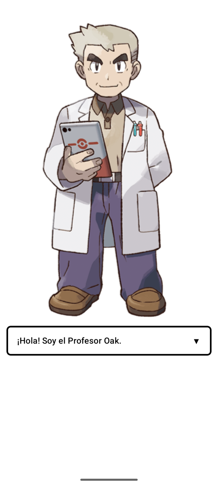 | 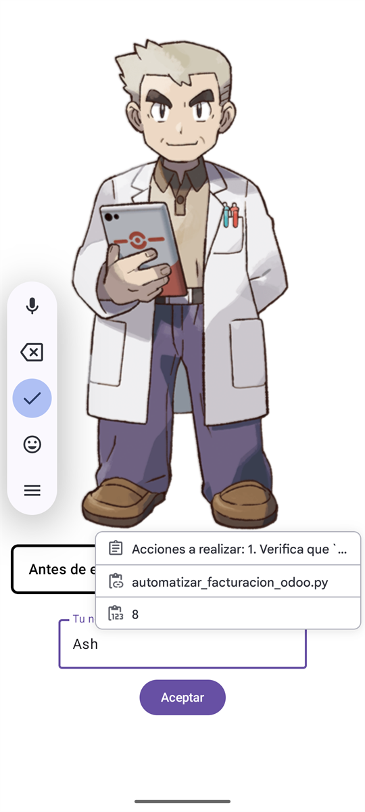 |
| Oak da la bienvenida con el retrato en reposo. | Escritura del nombre del entrenador. |
| 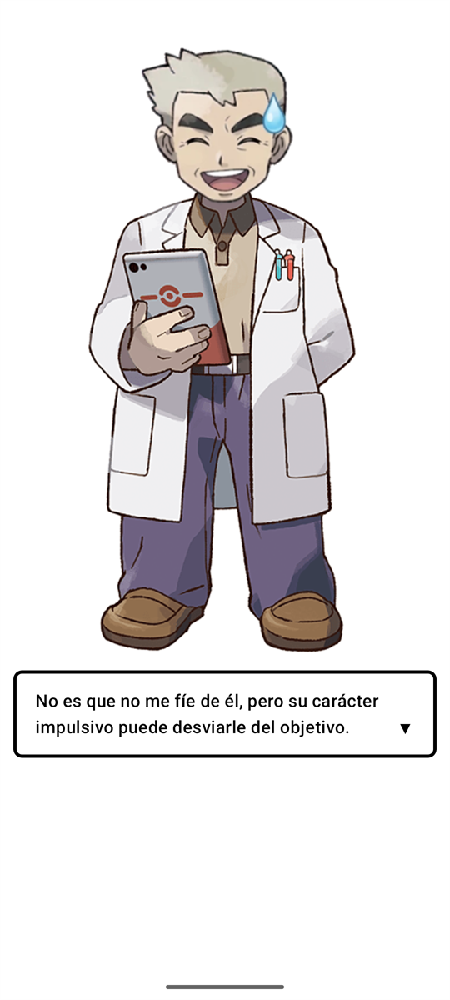 | 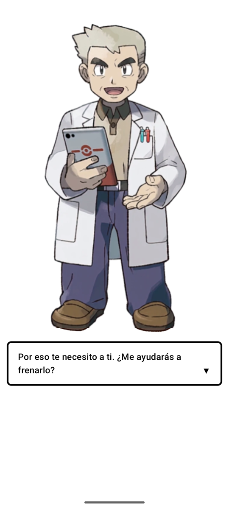 |
| Emoción de gota de sudor al hablar del carácter de Green. | Retrato de ofrecimiento: Oak tiende la mano y pide ayuda. |
| 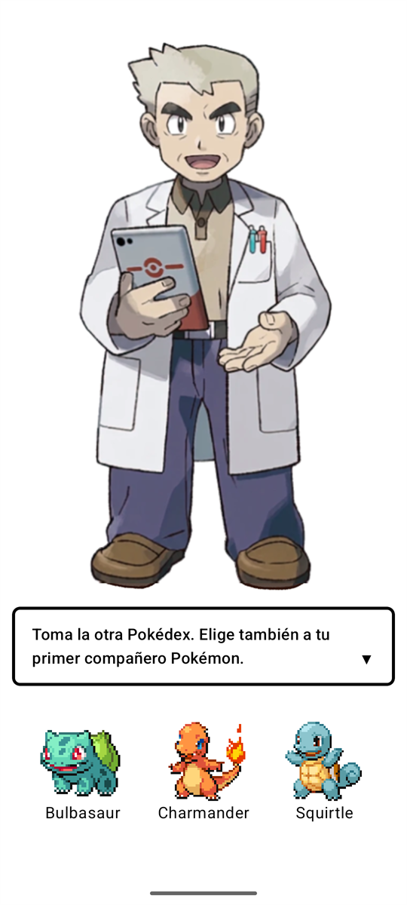 | 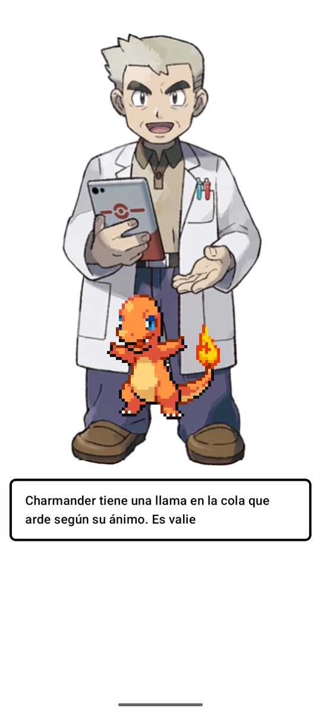 |
| Selector de starter: los tres sprites animados. | Ficha del starter elegido y confirmación Sí / No. |
| 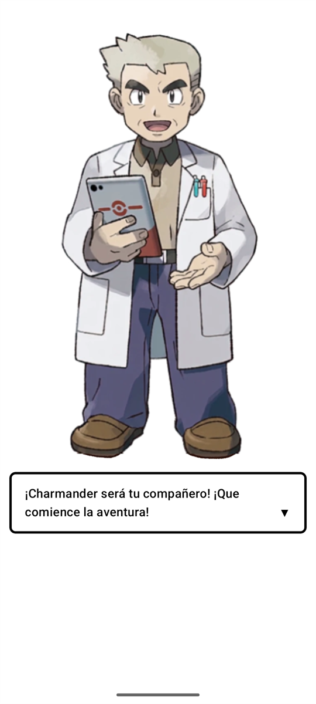 | |
| Despedida antes de empezar la partida. | |

Commits: `3c96edc` guion nuevo, `14d9f2d` bloque de intro más bajo, `32a8eb0` merge del PR #77.

---

## 2. Tutorial guiado para partidas nuevas

Siete pasos que enseñan el bucle antes de soltar al jugador.

- Oak pregunta si es la primera vez y ofrece el tutorial; una segunda confirmación evita que un «Sí» accidental fuerce el recorrido.
- El tutorial pide desplegar la Pokébola con un arrastre real, abrir el mapa y abrir la Pokédex, y espera cada acción.
- Mientras hay un mensaje visible toda la interfaz de juego queda inerte: ni la Pokébola suma experiencia ni los destinos del menú navegan.
- Al llenar la barra de experiencia aparece el aviso de avance y el botón superior se habilita.
- La fase del tutorial se persiste junto a la partida, así que sobrevive al cierre de la aplicación.

| | |
| --- | --- |
| 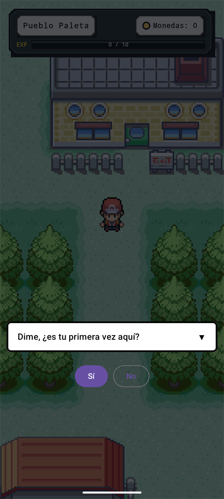 | 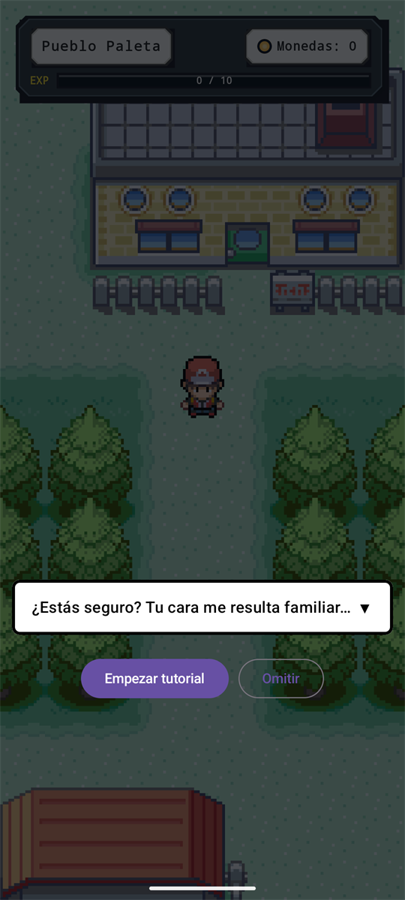 |
| Oak ofrece el tutorial; el mundo queda en segundo plano. | Confirmación con Empezar tutorial / Omitir. |
| 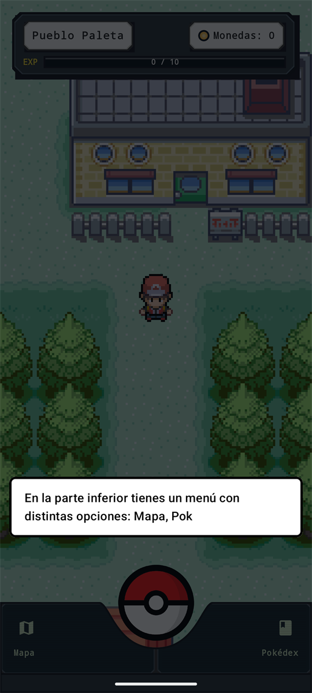 | 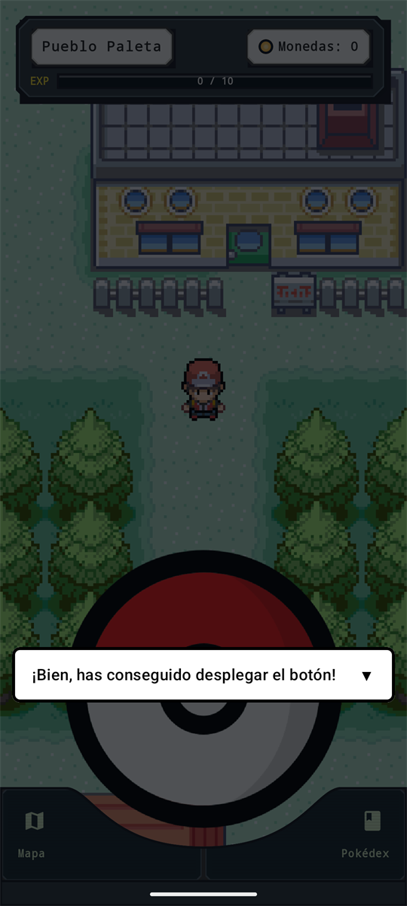 |
| Paso 1: instrucción de arrastrar la Pokébola. | La Pokébola desplegada, con el aviso de éxito. |
| 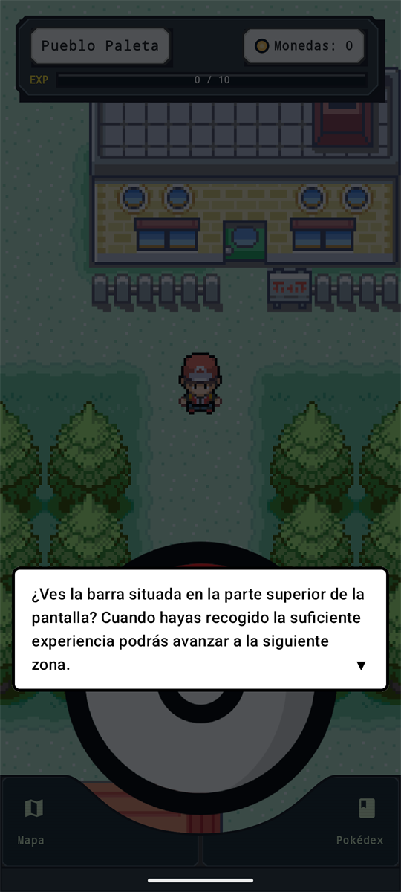 | 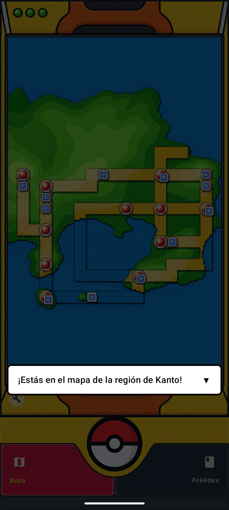 |
| Explicación de la barra de experiencia de la zona. | Paso 2: el mapa de Kanto abierto desde el tutorial. |
| 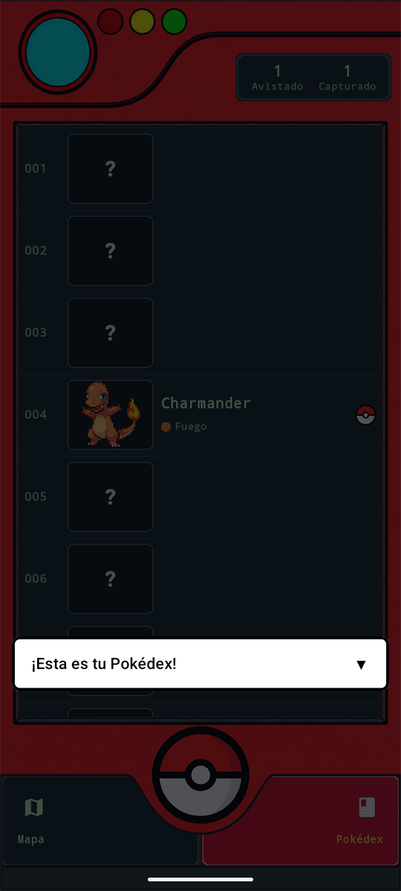 | 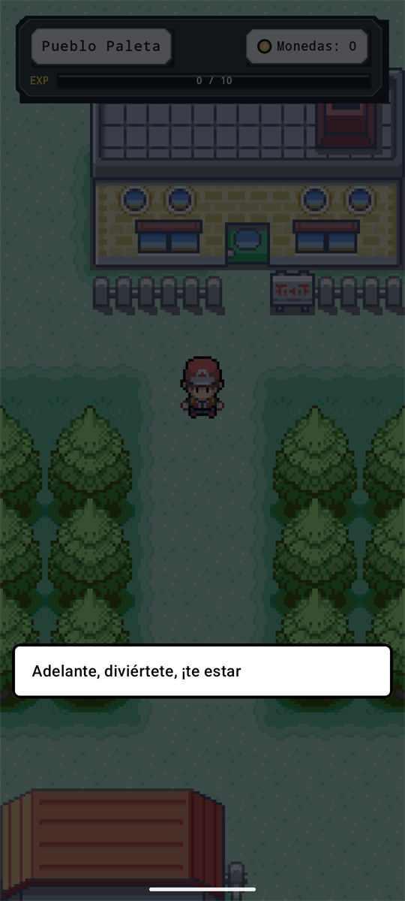 |
| Paso 3: la Pokédex con el primer registro. | Despedida de Oak y fin del tutorial. |

Commits: `e323f2b` tutorial interactivo, `7af231a` bloqueo de navegación al volver de la Pokédex, `a9e8251` limpieza, `5193954` guarda completa de despliegue, `d2f1a95` documentación, `60057f1` merge del PR #90.

> Las capturas del tutorial conservan el velo oscuro del overlay: es el estado real de la pantalla durante el recorrido.

---

## 3. Minijuego de captura

El encuentro salvaje pasa a ser un panel LCD con carril y medidor.

- El marco del encuentro es un panel LCD retro con dos columnas: el carril vertical y el medidor de captura.
- La Pokébola del menú se lanza con una parábola hasta el carril y se queda 300 ms en el centro antes de caer.
- El carril corre a 60 fps usando el delta real del tick, con rebote sutil en los bordes.
- El medidor de captura tiene degradado vertical y se vacía si no se acierta, hasta que el salvaje escapa.
- Se añadió el efecto de hojas en los pies del entrenador al tocar la hierba alta, con fundido alfa real.

| | |
| --- | --- |
| 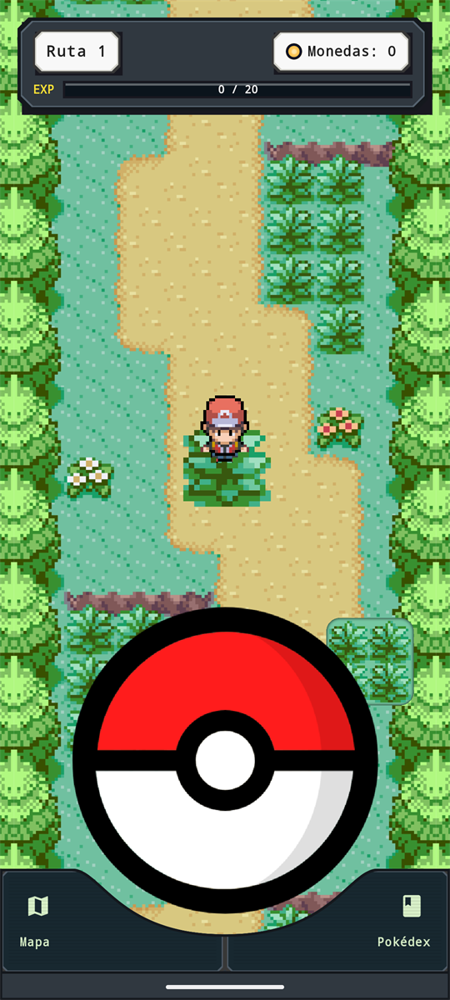 | 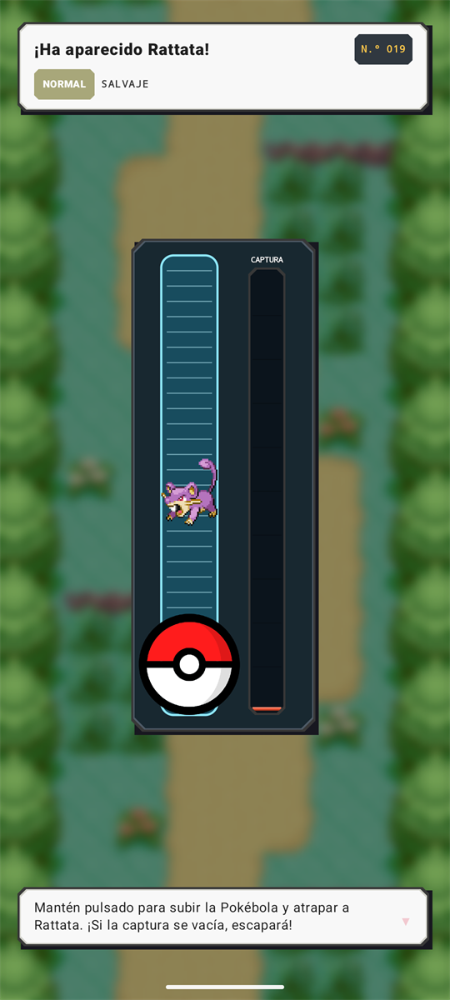 |
| Modo hierba alta: el overlay cubre al entrenador. | Panel LCD del encuentro con carril, medidor y la Pokébola abajo. |
| 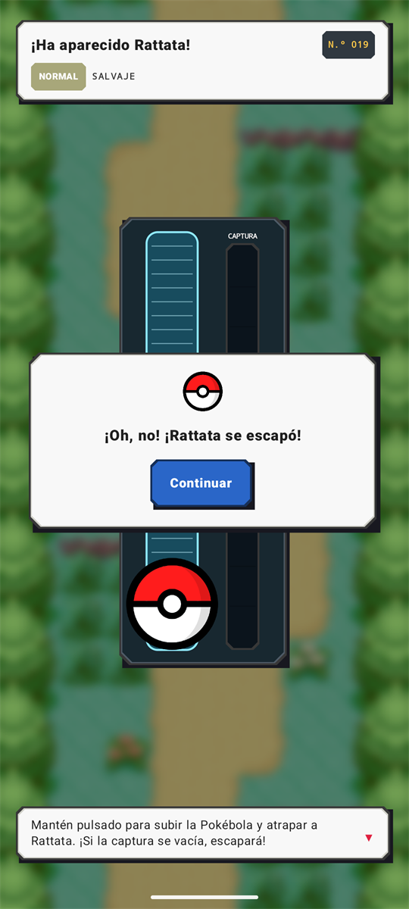 | |
| Resultado del intento fallido, con el botón Continuar. | |

Commits: `4abf549` panel LCD, `cec2f74` marco más ancho, `0b67429` lanzamiento desde el menú, `c6c87e5` parábola más lenta, `e9ee266` pausa en el centro, `e1b7382` 60 fps, `e62f1a0` rebote en bordes, `b648e05` / `4ded121` / `f2665db` hojas, `ef9e9cc` reversión del efecto, `dc81ce0` degradado del medidor.

---

## 4. Pokédex de Kanto

Pantalla propia con carcasa de Pokédex y estados por especie.

- La Pokédex registra las 151 especies de Kanto con tres estados: desconocida, avistada y capturada, más el registro heredado de partidas anteriores.
- Los contadores de avistados y capturados se calculan a partir del estado real de la partida.
- Los sprites se dibujan con filtro nearest-neighbour y se recorta el margen transparente para que se vean más grandes.
- La proyección de la dex se extrajo del ViewModel a un proyector propio, con pruebas de catálogo, parser y guardas.
- La pantalla se abre desde las opciones y desde el tutorial, y queda bloqueada durante un combate o un minijuego.

| | |
| --- | --- |
| 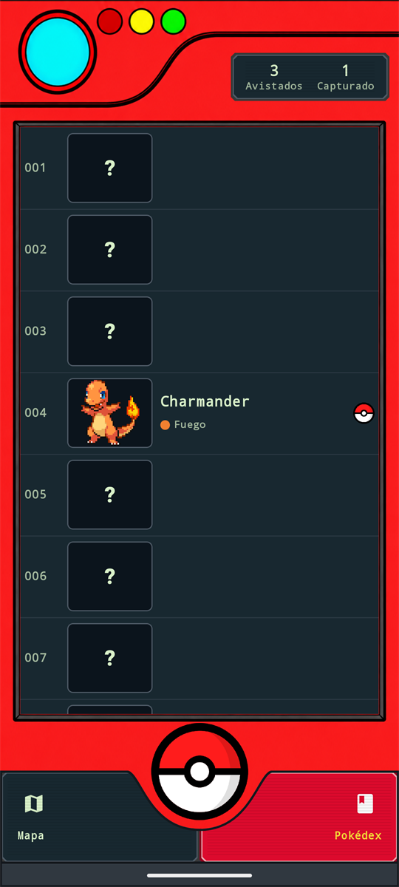 |  |
| Pokédex completa: contadores, sprite capturado y carcasa roja. | La misma pantalla abierta por el tutorial, con Charmander registrado. |

Commits: `9d4e4d3` Pokédex con estados, `fed4026` estado REGISTERED, `4135be3` nearest-neighbour, `834384b` recorte de margen, `ae1582c` proyector propio, `7c1134e` dobles de ViewModel, `ad65634` carcasa con menú inferior real.

---

## 5. Catálogo de Kanto: 151 especies, 15 tipos y encuentros

El modelo de datos deja de ser una muestra y cubre la primera generación completa.

- Las 151 especies de Kanto viven en `Catalogs.kt` con sus tipos, y `pokedex_catalogo.json` acompaña el asset de la dex.
- Los 15 tipos estrenan tabla de efectividades y se aplican al cálculo de daño del combate de gimnasio.
- Los encuentros salvajes se reparten por zona según una tabla explícita, y Mt.Moon puede generar salvajes sin el modo hierba alta.
- `docs/apariciones-planificadas.md` documenta el reparto de apariciones y lo que queda por conectar.

Commits: `acacad1` 15 tipos y efectividades, `6b40856` 151 especies, `c2ddd20` encuentros ampliados y documentados, `acb1449` merge del PR #96.

---

## 6. Zonas y fondos con arte propio

Cada zona estrena ilustración, eje de desplazamiento y umbral ajustado.

- Ciudad Verde, Ruta 3, Mt.Moon, Ciudad Plateada y Ciudad Celeste estrenan arte pixel-art con su propio eje de scroll: horizontal en las rutas y ciudades costeras, vertical en Ciudad Plateada.
- Mt.Moon funciona como cueva: los salvajes aparecen caminando, sin necesidad del modo hierba alta.
- Los umbrales se reequilibraron: Ciudad Plateada sube a 140 clics y Ruta 3 a 150.
- El fondo del gimnasio del agua pasa a arte pixel-art compartido con el resto de escenarios.

| | |
| --- | --- |
| 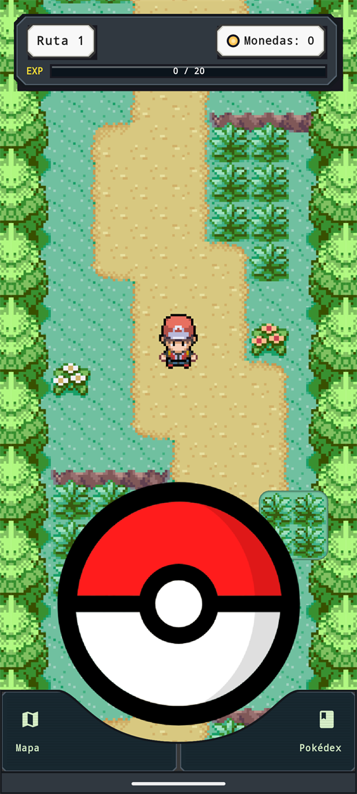 | 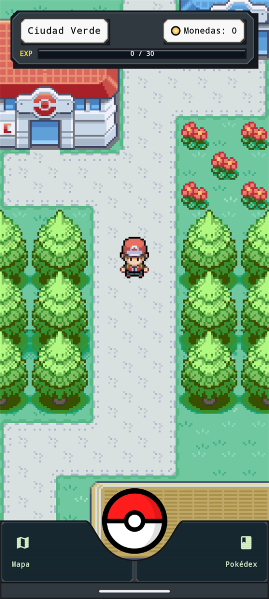 |
| Ruta 1: hierba alta, flores y camino de tierra. | Ciudad Verde: Centro Pokémon, árboles y flores. |
| 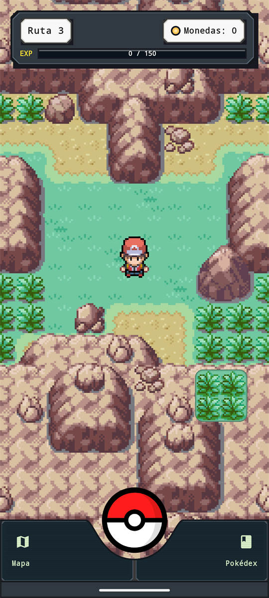 | 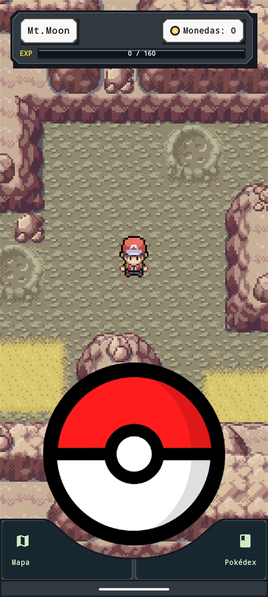 |
| Ruta 3: terreno rocoso con vegetación baja. | Mt.Moon: cueva con salvajes al caminar. |
| 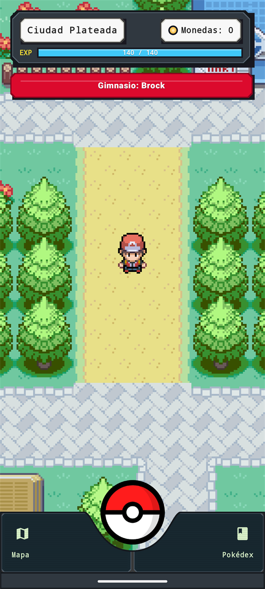 | 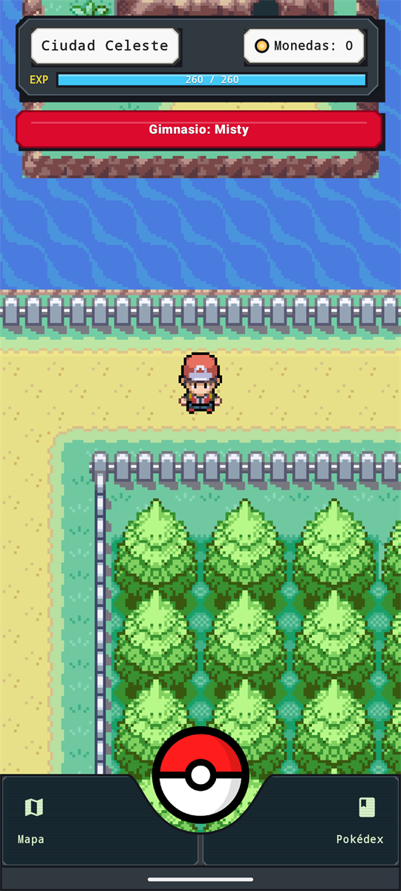 |
| Ciudad Plateada con la CTA roja del gimnasio de Brock. | Ciudad Celeste: agua, arena y gimnasio de Misty disponible. |

Commits: `866b737` Ciudad Verde, `0ca6e35` Ruta 3, `31b2e2d` Mt.Moon, `936af30` salvajes en cueva, `b921b0c` Ciudad Plateada, `9f3baad` Ciudad Celeste, `da539a0` balance de umbrales.

---

## 7. Mapa de Kanto y menú inferior

Carcasa de consola sobre el mapa y un menú que ya no mueve el mundo.

- El mapa se dibuja dentro de una carcasa de consola con pantalla, bisagras y ruedecillas, y la Pokébola deja de arrastrarse sobre la carcasa.
- Sobre el mapa la Pokébola no se expande: un arrastre completo cuenta como toque y devuelve a la aventura.
- El hueco del menú inferior se reserva siempre, se dibuje o no, para que el entrenador no salte cuando aparece.
- La barra de acero con la hendidura central se abre a la vez que la Pokébola y comparte su progreso de gesto.

| | |
| --- | --- |
| 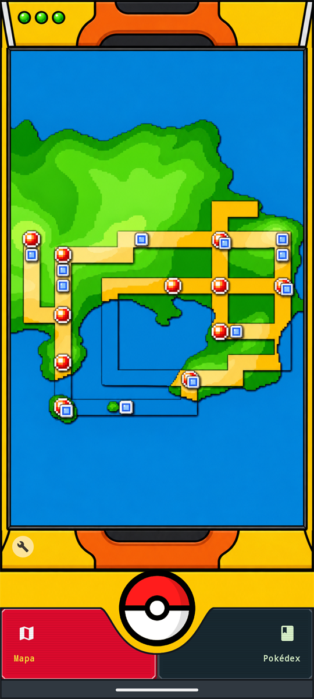 | 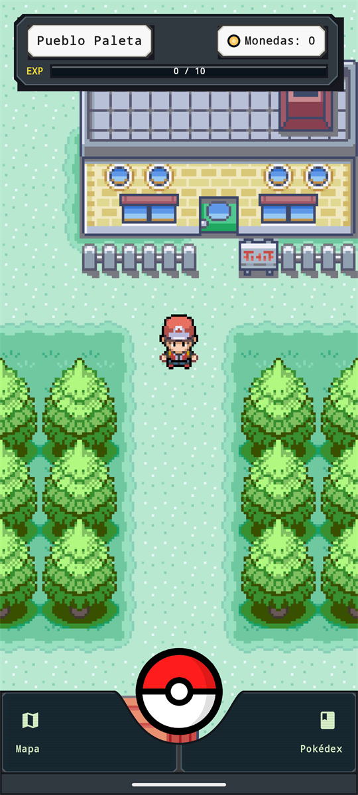 |
| Mapa de Kanto con carcasa de consola y regiones marcadas. | Pantalla principal con el menú inferior en reposo. |
|  | 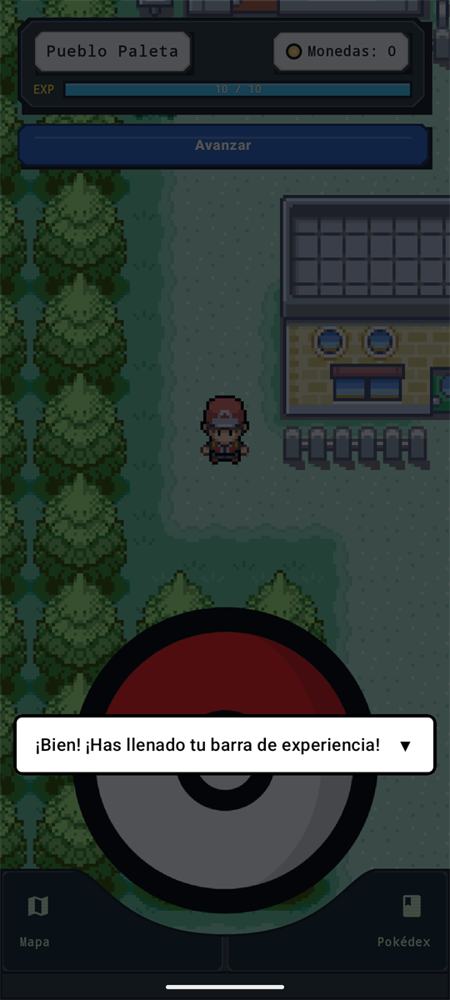 |
| La Pokébola desplegada y la hendidura del menú abierta. | Bola desplegada con la barra de experiencia al completo. |

Commits: `9c4d440` carcasa del mapa, `2cd3e3d` mundo quieto con el menú, `4330677` merge del PR #86, `447fcc4` merge del PR #83.

---

## 8. Gimnasio de Brock

Entrada, discurso, tutorial y combate de la mecánica de rocas.

- Cortinilla de entrada con las dos mitades de la Pokébola, discurso del líder con retratos y cambio de cara al oír lo del Team Rocket.
- El discurso termina en la pregunta del tutorial, con los botones Ver tutorial y Omitir.
- El combate lanza rocas por columnas: se rompen tocándolas antes de que alcancen al Pokémon; cada acierto llena la postura del líder y cada fallo la resta.
- Al romper la postura el líder queda expuesto y se le puede tocar para restar vida; bajo un cuarto de vida entra en furia.
- El HUD del combate usa barras de PS y placas con el nombre, al estilo de los juegos originales.

| | |
| --- | --- |
| 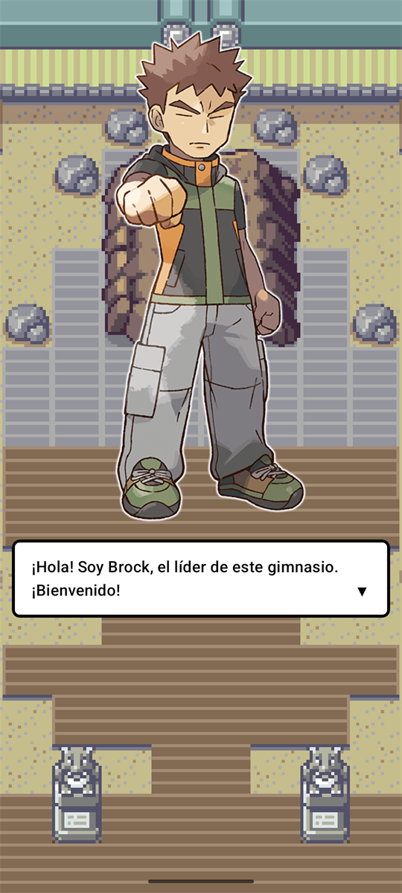 | 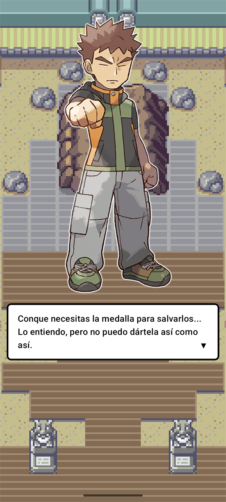 |
| Entrada al gimnasio con el retrato de Brock. | Diálogo de la medalla antes del combate. |
| 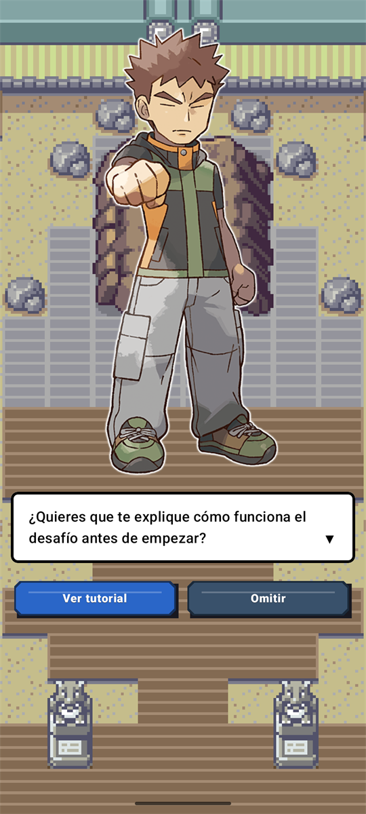 | 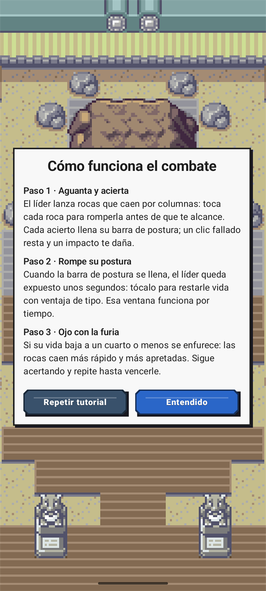 |
| Oferta del tutorial del combate: Ver tutorial / Omitir. | Los tres pasos del tutorial del combate. |
| 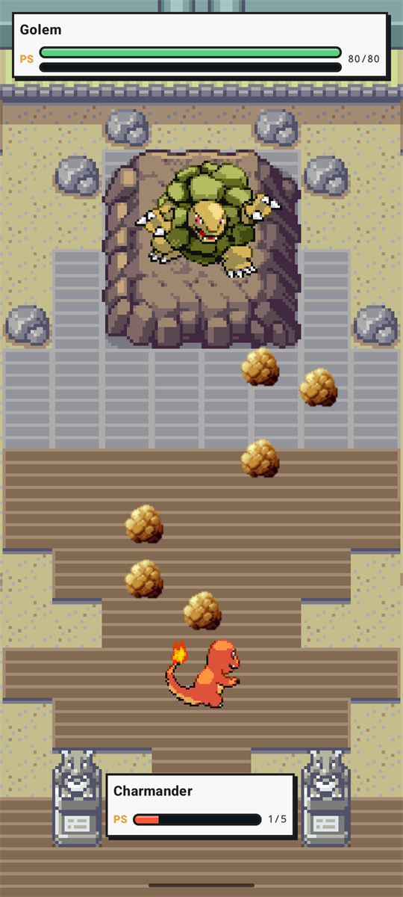 | 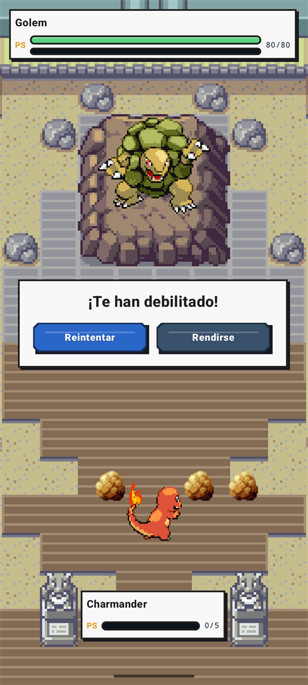 |
| Combate: rocas cayendo por columnas y barras de PS. | Diálogo de derrota con Reintentar / Rendirse. |

Commits: `b19ae22` arte del gimnasio, `b01c890` pantallas de entrada, furia y victoria, `a44325a` combate de rocas, `18dc1f7` pruebas, `1806a3c` documentación, `0de295d` marco de diálogo compartido, `553558d` HUD estilo Pokémon, `2b70a8e` merge del PR #92.

---

## 9. Gimnasio de Misty

Misma presentación que Brock, con anillos, agua y contador de combo.

- Misty estrena guion propio con tres retratos: contenta con la boca abierta y cerrada, sorprendida y media sonrisa.
- El combate cambia de mecánica: los anillos se cierran sobre el Pokémon y hay que pulsar cuando el anillo móvil toca el anillo fijo.
- Los anillos llevan efectos de agua reales y el anillo fijo del jugador se tiñe en verde al acertar y en rojo al fallar.
- Cada acierto suma combo y el resultado se anuncia con un cartel en tipografía pixel de 5×7 que aparece tras el contador.
- El tamaño de sprite pixel-art se comparte entre Brock y Misty para que ambas escenas escalen igual.

| | |
| --- | --- |
| 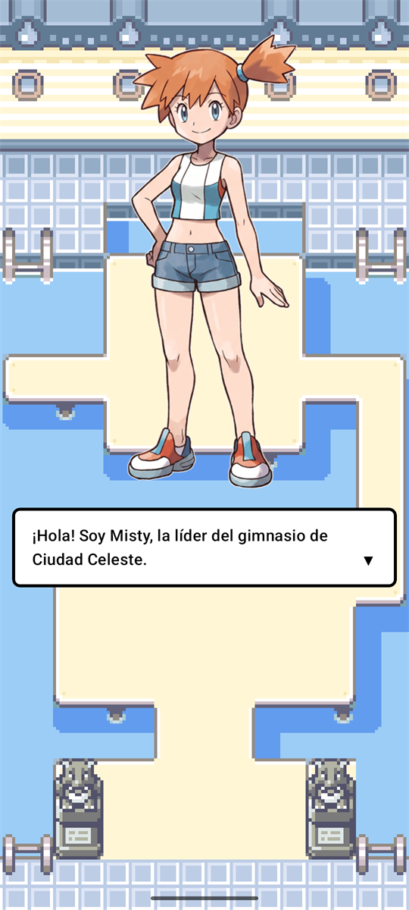 | 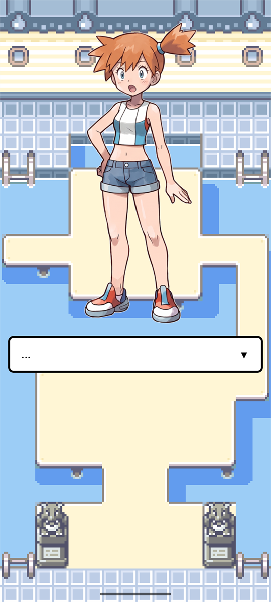 |
| Entrada al gimnasio con el retrato de Misty. | Retrato de sorpresa mientras escucha lo del Team Rocket. |
| 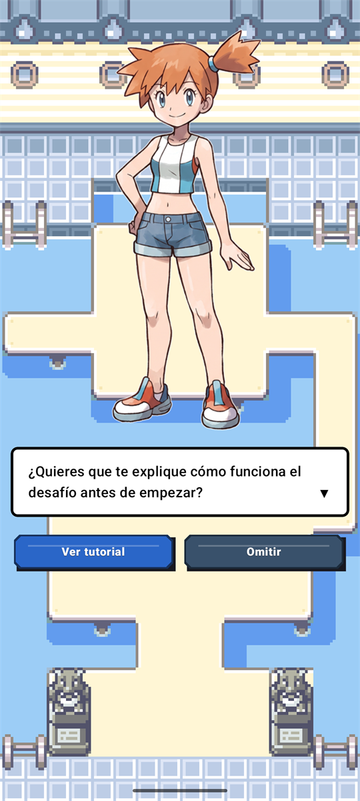 | 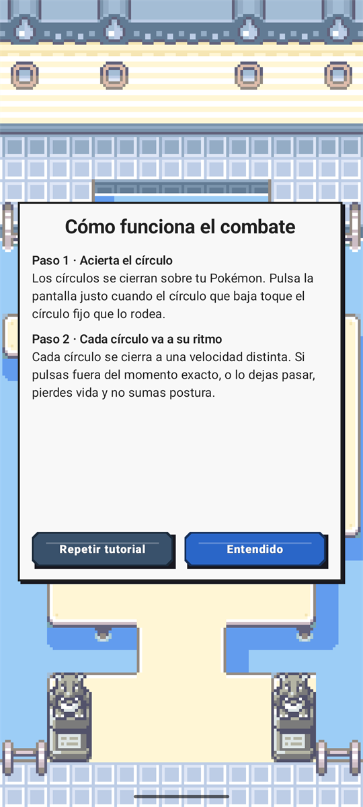 |
| Oferta del tutorial, con la misma presentación que Brock. | Tutorial de la mecánica de anillos. |
| 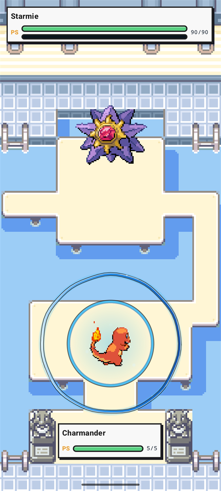 | 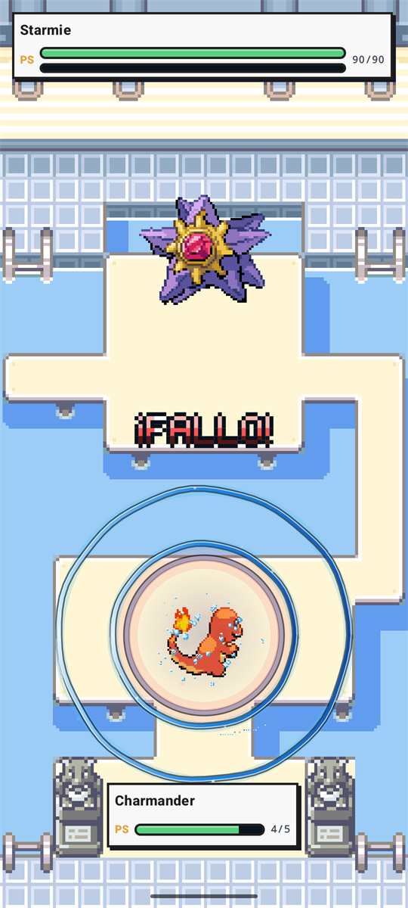 |
| Combate de anillos con Charmander en el centro. | Anillo cerrándose y cartel pixelado de fallo. |

Commits: `18106b7` escala compartida, `d0c945d` fondo pixel-art, `f030172` efectos de agua, `965f253` verde/rojo en el anillo, `3379d9f` tinte del anillo fijo, `b7c31ad` combos en el cartel, `e807179` tipografía 5×7, `eb01b1b` cartel tras el contador, `71ead1d` fin de la barra de tiempo, `74cc25b` presentación completa, `f2932aa` retrato más grande y medalla sobre el diálogo, `1afe488` medalla sobre el centro, `44e3e0c` limpieza.

---

## Documentación y pruebas

- `DOCUMENTACION.md` recoge el tutorial, el gimnasio de roca y los cambios de arquitectura del rango.
- `docs/apariciones-planificadas.md` documenta la tabla de encuentros.
- La batería de pruebas unitarias crece con 19 archivos de prueba nuevos: tutorial, gimnasio, intro, Pokédex, captura, fondos y persistencia.

```
./gradlew testDebugUnitTest     # 35 suites · 563 pruebas · 0 fallos
./gradlew assembleDebug
```

---

## Cómo se obtuvieron las capturas

- Emulador headless: `emulator -avd Medium_Phone_API_37.0 -no-window -no-audio -no-boot-anim -gpu swiftshader_indirect`.
- Instalación de `app-debug.apk` con ADB y arranque de `MainActivity` sin ninguna interacción manual.
- Navegación por el árbol de vistas (`uiautomator dump` + `input tap`) y captura con `screencap`, todo lanzado desde los scripts de `scripts/`.
- Los atajos de desarrollo de la hoja de opciones (Ciudad Plateada, Ciudad Celeste y Ciudad Carmín) se usaron para llegar a los gimnasios sin recorrer Kanto entera.
- Las imágenes de este informe se redujeron a 540 px de ancho para que el documento y la pull request carguen rápido.

---

*Documento generado a partir de los commits del rango `main..dev` y de las capturas del emulador.*
